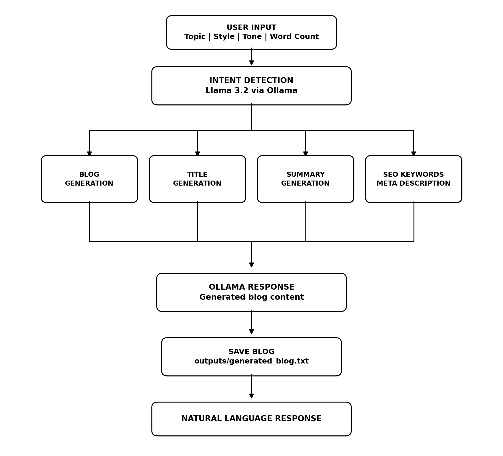

# AI-Powered Blog Content Generator using Ollama

Experiment 2 of **24CS2506 - Building Applications using GPT-4**.

A modular blog content generator that runs entirely on a local machine using
**Llama 3.2** served by **Ollama**. It generates a complete blog from a topic,
writing style, tone and word count, and also produces blog titles, SEO keywords,
a summary and an SEO meta description. An Ollama based intent detector routes
free-text requests to the correct module.

## Setup

```bash
ollama pull llama3.2
ollama serve

python3 -m venv .venv && source .venv/bin/activate
pip install -r requirements.txt
```

## Run

```bash
python main.py
```

## Modules

| File | Responsibility |
|------|----------------|
| `input_module.py` | Collects and validates topic, style, tone and word count |
| `blog_module.py` | Builds the prompt and generates the blog with Llama 3.2 |
| `title_module.py` | Generates exactly five blog titles |
| `summary_module.py` | Generates a summary of about 100 words |
| `keyword_module.py` | Generates SEO keywords |
| `meta_module.py` | Generates a meta description within 160 characters |
| `intent_module.py` | Detects BLOG_GENERATION / SUMMARY / KEYWORD_GENERATION / META_DESCRIPTION |
| `utils.py` | Ollama client, formatting and file handling |
| `main.py` | Menu driven application with continuous interaction |

## System architecture



## Output screenshots

| | |
|---|---|
| Home screen |  |
| User input |  |
| Blog generation |  |
| Blog titles |  |
| Summary |  |
| SEO keywords |  |
| Meta description |  |
| Blog saved |  |
| Intent detection |  |
